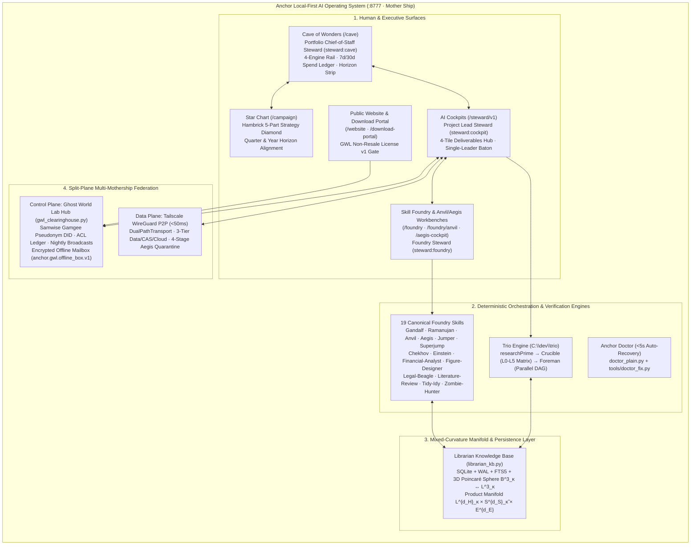
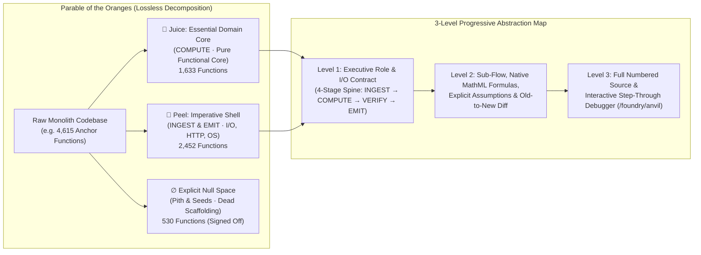
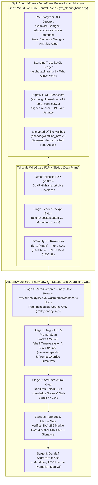
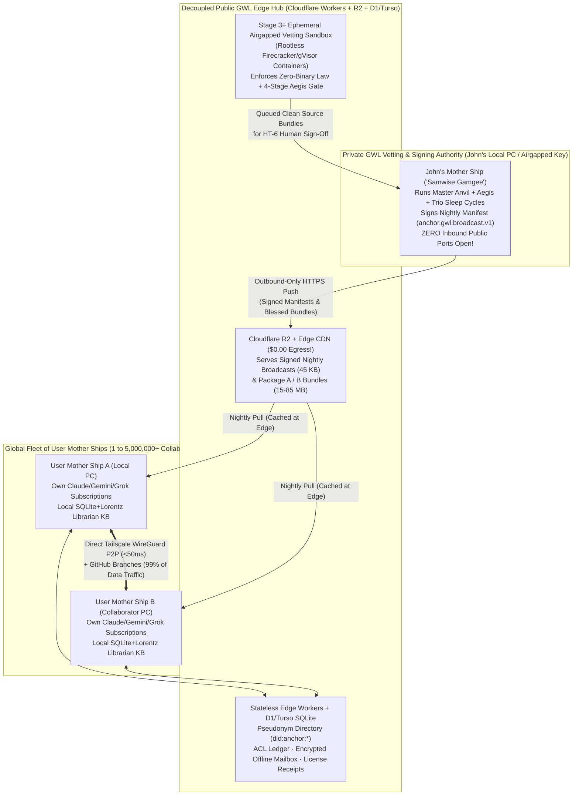

# Master Chronicle of Anchor & Skill Foundry: Complete Architecture History, Mathematical Foundations & Ghost World Hub Scaling Blueprint

- **Document ID:** `ANCHOR-COMPLETE-CHRONICLE-AND-ARCHITECTURE-HISTORY`
- **Version:** `1.4.3 · Wave 24 Archival Edition`
- **Date:** `2026-10-22`
- **Author & Principal Architect:** John C. Liechty (*Ghost World Labs · Powered by NextGen Nuclear · AI Cockpit*)
- **Default Collaborator Pseudonym:** `"Samwise Gamgee"` (`did:anchor:samwise-gamgee`, aliases `["Samwise Gamgi", "Samwise"]`)
- **Primary Repositories:** `C:\dev\Anchor`, `C:\dev\Skill Foundry`, `C:\dev\trio`, `C:\dev\Anchor-Improvement`
- **Rights Notice:** `GHOST-WORLD-LAB-NON-RESALE-v1` (*All rights reserved — not open source*)

---

## Table of Contents

1. [**Part I — Executive Summary & Genesis of Anchor**](#part-i--executive-summary--genesis-of-anchor)
   - [1.1 Genesis: From Early Agentic Sessions to a Local-First AI Operating System](#11-genesis-from-early-agentic-sessions-to-a-local-first-ai-operating-system)
   - [1.2 The Cave of Wonders (Portfolio Chief-of-Staff Command Center)](#12-the-cave-of-wonders-portfolio-chief-of-staff-command-center)
   - [1.3 AI Cockpits (Focused Project Execution, Single-Leader Baton & 3-Tier Data)](#13-ai-cockpits-focused-project-execution-single-leader-baton--3-tier-data)
   - [1.4 The 19-Skill Foundry & Trio Engine](#14-the-19-skill-foundry--trio-engine)
   - [1.5 The 3D/ND Poincaré Sphere & Mixed-Curvature Lorentz Librarian KB](#15-the-3dnd-poincaré-sphere--mixed-curvature-lorentz-librarian-kb)
2. [**Part II — Complete Wave-by-Wave Historical Record (Wave 0 through Wave 24)**](#part-ii--complete-wave-by-wave-historical-record-wave-0-through-wave-24)
   - [2.1 Master Wave Directory & Verification Ledger](#21-master-wave-directory--verification-ledger)
   - [2.2 Detailed Wave-by-Wave Engineering Chronicle (Waves 0–24)](#22-detailed-wave-by-wave-engineering-chronicle-waves-024)
   - [2.3 Formative Friction Incidents & Release v1.4.3 Stabilization](#23-formative-friction-incidents--release-v143-stabilization)
3. [**Part III — Major Engineering, Mathematical & Security Breakthroughs**](#part-iii--major-engineering-mathematical--security-breakthroughs)
   - [3.1 Breakthrough 1: Doctor `<5s` Deterministic Auto-Recovery (`doctor_plain.py` + `tools/doctor_fix.py`)](#31-breakthrough-1-doctor-5s-deterministic-auto-recovery-doctor_plainpy--toolsdoctor_fixpy)
   - [3.2 Breakthrough 2: Anvil Programmatic Codebase Comprehension & Remapping Across All 19 Skills](#32-breakthrough-2-anvil-programmatic-codebase-comprehension--remapping-across-all-19-skills)
   - [3.3 Breakthrough 3: 3D/ND Poincaré Spheres ($\mathbb{B}^3_\kappa / \mathbb{B}^d_\kappa$), Orthogonal Knowledge Dimensions & Lorentz Hyperboloid Stability (`librarian_kb.py`)](#33-breakthrough-3-3dnd-poincaré-spheres-mathbbb3_kappa--mathbbbd_kappa-orthogonal-knowledge-dimensions--lorentz-hyperboloid-stability-librarian_kbpy)
   - [3.4 Breakthrough 4: `Crucible` (`0108`) & `Foreman` (`0139`) Sleep-Cycle Evolution](#34-breakthrough-4-crucible-0108--foreman-0139-sleep-cycle-evolution)
   - [3.5 Breakthrough 5: Multi-Anchor Federation, `"Samwise Gamgee"` Pseudonym Identity, Nightly GWL Broadcasts & The Anti-Spyware Zero-Binary Law](#35-breakthrough-5-multi-anchor-federation-samwise-gamgee-pseudonym-identity-nightly-gwl-broadcasts--the-anti-spyware-zero-binary-law)
   - [3.6 Breakthrough 6: Ghost World Lab Non-Resale License v1, Download Portal & Opt-In Sanitized Feedback Loop (`website_portal.py`)](#36-breakthrough-6-ghost-world-lab-non-resale-license-v1-download-portal--opt-in-sanitized-feedback-loop-website_portalpy)
4. [**Part IV — Ghost World Hub Resource & Scaling Blueprint (From Local "Puter" to GitHub-Scale)**](#part-iv--ghost-world-hub-resource--scaling-blueprint-from-local-puter-to-github-scale)
   - [4.1 Why Anchor Scales at $<1\%$ of Centralized AI SaaS Cost](#41-why-anchor-scales-at-1-of-centralized-ai-saas-cost)
   - [4.2 Stage 1: Local "Puter" + Tailscale + GitHub (`1 – 100 Collaborators`, `$0/mo`)](#42-stage-1-local-puter--tailscale--github-1--100-collaborators-0mo)
   - [4.3 Stage 2: Decoupled Edge Hub (`100 – 10,000 Users`, `$5 – $25/mo`)](#43-stage-2-decoupled-edge-hub-100--10000-users-5--25mo)
   - [4.4 Stage 3: Regional Federation & Automated Airgapped Vetting (`10,000 – 100,000 Users`, `$75 – $250/mo`)](#44-stage-3-regional-federation--automated-airgapped-vetting-10000--100000-users-75--250mo)
   - [4.5 Stage 4: "GitHub-Scale" Global Ecosystem (`100,000 – 5,000,000+ Users`, `$500 – $2,500/mo`)](#45-stage-4-github-scale-global-ecosystem-100000--5000000-users-500--2500mo)
   - [4.6 Master 4-Stage Resource, Bandwidth & Cost Comparison Matrix](#46-master-4-stage-resource-bandwidth--cost-comparison-matrix)

---

## Part I — Executive Summary & Genesis of Anchor

### 1.1 Genesis: From Early Agentic Sessions to a Local-First AI Operating System

Anchor began with a deceptively simple question: *What if a principal researcher, software architect, or executive could orchestrate multiple frontier AI model families simultaneously across a portfolio of complex, long-running initiatives without losing context, without drifting from the core objective, and without surrendering private intellectual property to a multi-tenant cloud?*

Early agentic sessions (`Ecgberht`, `Aladdin`, `Jarvis`) exposed the fundamental failure modes of raw CLI and chat-window workflows:
1. **Context Amnesia & Window Compaction:** Long-running builds or multi-paper research campaigns overflowed single-session token windows, losing architectural invariants and repeating already-refuted mistakes.
2. **Single-Family Blind Spots:** Any single model family (`Claude`, `Gemini`, `Grok`, or `ChatGPT`) reviewing its own plans or code suffered from correlated blind spots and sycophantic self-approval.
3. **Unstructured Prose Thrash:** Without deterministic gates—real test suites, AST security scanners, lossless syntax-tree refactoring, and mathematical verification scripts—agents debated prose while leaving subtle runtime bugs unfixed.
4. **Portfolio Fragmentation:** Working across a dozen concurrent efforts (teaching courses, writing books, building financial engines, designing nuclear/AI systems, and collaborating with peers like Merrill) required a unified Chief-of-Staff layer rather than twenty disconnected terminal windows.

Over **25 engineering waves (`Wave 0` through `Wave 24`)**, Anchor evolved into a **complete, local-first AI Operating System and Multi-Mothership Federation Platform** served locally at `:8777` (`anchor.py`, `anchor_gui.py`) with zero external Python package dependencies on its core control path (`100%` Python standard library + deterministic local SQLite/Node/AST engines).



---

### 1.2 The Cave of Wonders (Portfolio Chief-of-Staff Command Center)

The **Cave of Wonders** (`high_seat_page.py`, `high_seat_core.py`, `high_seat_ingest.py`, `high_seat_compute.py`, `high_seat_emit.py`) is the user's daily executive command deck:
- **Portfolio Chief-of-Staff Persona (`Aladdin` / `Jarvis` / `Ecgberht`):** Configured globally in `/setup` and embodied by the `steward:cave` incarnation. It triages deadlines, reads and schedules live calendar events, ingests email headers into **The Desk**, and coordinates across all active AI Cockpits.
- **4-Engine Subscription Rail & 2-Role Model Policy (`provider-controls.js`, `anchor_settings.py`):** Displays live connection status, OAuth CLI health, and remaining rate-limit allowance across **Claude** (`claude.exe`), **Gemini** (`agy` / `gemini-cli`), **Grok** (`grok.exe`), and **ChatGPT** (`codex`). Model routing is governed by the streamlined **2-Role Model Policy**:
  - **Orchestrator (`orchestrator_family`):** Drives Terminal, Coder, and primary skill execution.
  - **Reviewer (`reviewer_family`):** Drives adversarial Reviewer and Judge seats for honest cross-family validation.
- **7-Day & 30-Day Hypothetical API Equivalent Spend Ledger (`steward_routes.py`, `api_list_prices.json`, `usage_allowance_monitor.py`):** Tracks every token consumed across flat-rate subscription CLIs and calculates its exact hypothetical API list-price value (`"Est. API equiv: $X,XXX.XX"`), updated nightly via `ft.py sync-models-prices` and deduplicated across `.anchor/usage_ledger/*.json`.
- **Collapsed-by-Default `Today / 1-Week / Month / Quarter / Year` Horizon Strip:** Keeps the Cave uncluttered at startup while expanding on click to show tactical `Today` and `1-Week` actions alongside strategic `Month`, `Quarter`, and `Year` milestones with drag-and-drop card rescheduling and `1-click ✓ Done` / `+3d` actions.
- **Star Chart Strategy Tie-In & Collaborator Clearinghouse:** Links tactical daily work directly to the **Hambrick & Fredrickson 5-Part Strategy Diamond** on the Star Chart (`WAVE20-STAR-CHART-HAMBRICK-STRATEGY-2026-10-19.md`) and hosts the **Multi-Mothership Collaboration Strip** (`#caveCollabStrip`) for managing peer invitations, Standing Trust ACL grants, and Nightly GWL Broadcasts.

---

### 1.3 AI Cockpits (Focused Project Execution, Single-Leader Baton & 3-Tier Data)

Each project or initiative runs inside an isolated **AI Cockpit** (`steward_cockpit/`, `v1.html`, `shared.js`, `cockpit_baton_and_tiers.py`):
- **Project Lead Steward (`steward:cockpit`) & Locked North Star:** Every cockpit displays its expandable **Goal Tagline / North Star Bar** across the top, its `🪦 Boneyard` retirement control, and a mutual takeover toggle (`⚒️ Anvil` ↔ `🛡️ Aegis` ↔ `▴ AI Cockpit`). Any change to the locked North Star triggers mandatory human escalation (`HT-1`).
- **Hierarchical Plan Summary, Readable Wave Plan & Plan Refresh Proposals (`/api/plan-proposal`):** Users toggle effortlessly between a high-level Hierarchical Plan Summary and a spacious, full-width Wave Plan reader, inspect scrollable historical plan snapshots, and review explicit **Accept New Plan / Revert to Old Plan** proposals whenever new deliverables or instructions alter the roadmap.
- **Single 4-Tile Deliverables Hub (`Pending`, `For Review`, `Final`, `All`):** Organizes all project work products into four clean lifecycle buckets with newest-first sorting, instant search/sort filtering, 1-line expandable summaries, full split-screen rendering for `.md`, `.html`, `.pptx` (`office_preview.render_preview`), `.py`, and `.R` files, and automatic clearing of stale `For Review` flags whenever revision feedback is submitted in chat (`reconcile_review_on_feedback`).
- **3-Row Milestone ETA Status Card & Scrollable Status Log:** Enforces the universal locked status format (`Effort`, `Doing`, `Status`, `Tests`, `Blocker`, `Procs`, `Journal`, `ETA`, `To do`) with a click-to-open **Previous Status Updates** history drawer.
- **Single-Leader Cockpit Baton (`anchor.cockpit.baton.v1`):** Prevents distributed split-brain across collaborating Motherships via a cryptographically signed, monotonically increasing `baton_epoch` and per-step conflict-free leases (`claim_step_lease` / `release_step_lease`). Only the current Baton Holder can mutate structural roadmap topology, while non-lead collaborators freely execute and update their leased `step_id`s.
- **3-Tier Hybrid Resource Management (`classify_and_manifest_resources`):**
  - **Tier 1 (`< 5 MB`, `local_replicated`):** Cockpit JSONs, source code, and active manuscripts (`anchor.paper.sync.v1` with `doc_sha256` optimistic concurrency).
  - **Tier 2 (`5 MB – 500 MB`, `cas_pointer_link`):** Content-addressed pointer manifests (`anchor.resource.link.v1`) hydrated on demand into `.anchor/cas/sha256/<sha256>` without bloating Git repositories.
  - **Tier 3 (`> 500 MB`, `shared_cloud_workspace`):** External cloud compute/storage descriptors (`anchor.cloud.workspace.v1`) paired with lightweight (`< 50 KB`) cryptographically signed execution receipts (`anchor.cloud.receipt.v1`).

---

### 1.4 The 19-Skill Foundry & Trio Engine

Anchor's intelligence is modularized into **19 canonical, adversarial-grade skills** across `C:\dev\trio` and `C:\dev\Skill Foundry`:

| # | Skill ID | Category | Primary Role & Deterministic Engine |
| :---: | :--- | :--- | :--- |
| 1 | **`researchPrime`** | Trio Core (Research) | Stakes-scaled research engine with isolated Planning/Execution phases, `OBSERVED > CORROBORATED > CLAIMED > UNVERIFIED > REFUTED` evidence ladder, and origin-fused multi-reviewer verification. |
| 2 | **`crucible`** | Trio Core (Planning) | Production planning engine (`Stage 0 North Star -> Stage 1 Master Plan -> Stage 2 Implementation Plan`), upgraded in `0108` with **Multi-Level Adversarial Matrix Mode (`--matrix-fast-track`, `L0–L5`)**. |
| 3 | **`foreman`** | Trio Core (Build) | Autonomous multi-wave build orchestrator (`EXECUTE -> FAST-GATE -> DIFF-REVIEW -> FIX`), upgraded in `0139` with **Parallel Orthogonal Sub-Wave DAG Dispatch** & Orchestrator-Owned Ground-Truth Fast-Gate. |
| 4 | **`gandalf`** | Deep-Think & Audit | Deterministic host-graded deep-think advisor that critiques what is wrong, missing, or coming next, stamping honesty tiers in code rather than model self-assessment. |
| 5 | **`ramanujan`** | Formal Mathematics | Mathematical-reasoning partner governed by The Honesty Law (`[PROVED]`, `[VERIFIED-COMPUTATION]`, `[BOUNDED-ENVELOPE]`) with exact arithmetic/symbolic verification scripts. |
| 6 | **`anvil`** | Code Comprehension | Programmatic AST/LibCST codebase mapper: 3-Level Progressive Abstraction, Parable of the Oranges (`Juice` vs `Peel` vs `∅ Null Space`), 5-Seat Beta-Reader Panel, and Live Step-Through Debugger. |
| 7 | **`aegis`** | Defensive Security | Deterministic AST taint/sink scanner & auto-remediation engine across 6 OWASP/CWE families (`CWE-78`, `CWE-94/502`, `CWE-22`, `CWE-918`, `CWE-208/328`, `CWE-798`). |
| 8 | **`jumper`** | Rapid Ideation | High-order brainstorming engine composing Gandalf with SCAMPER, Analogical Transfer, and TRIZ under a 3-gate kill-filter. |
| 9 | **`superjump`** | Deep Analogical Leap | Structured cross-domain ideation engine with inspectable transfer traces and an independent cross-family Judge scored against a brief-derived Fit Contract. |
| 10 | **`chekhov`** | Literary & Story Memory | Project-local story dossier, continuity ledger, and structural revision partner for novels, series, and short-story collections. |
| 11 | **`einstein`** | Pedagogical Packs | Builds beginner-accessible course and self-study packs: illustrated guides, visual flashcards, worked solutions, and verified Python/R companions. |
| 12 | **`financial-analyst`** | Deal & Valuation Engine | Exact-`Decimal` dependency-graph valuation engine (VC round comp, real-estate equity waterfalls) compiling penny-exact synchronized Excel + Python models. |
| 13 | **`figure-designer`** | Scientific Visualization | Publication-grade SVG/PNG/PDF scientific figure architect enforcing Tufte/visual-hierarchy principles for ML, neuroscience, and systems schematics. |
| 14 | **`legal-beagle`** | Contract & Legal Review | Source-grounded contract compliance analyzer, case-law synthesizer, and plain-English companion drafter with strict anti-hallucination jurisdiction gates. |
| 15 | **`literature-review`** | Systematic Synthesis | Deterministic snowball search + PRISMA screening + one-call-per-paper quote-grounded claim extraction + weighted consensus matrix. |
| 16 | **`tidy-idy`** | Workspace Hygiene | Folder hygiene engine with an interactive Triage Panel (`Remove / SAVE / Reorg / Secrets`) and reversible Trash + optional Git commit. |
| 17 | **`zombie-hunter`** | Process Reaper | Evidence-armed background reaper that freezes or terminates only positively proven orphaned sub-agent trees under an abstain-by-default safety gate. |
| 18 | **`agy-dispatch`** | Cross-Family Transport | Subscription-CLI dispatcher routing token-heavy read/review/edit workloads to Gemini via `agy` with real-model attestation and zero PowerShell popups. |
| 19 | **`steward`** | 3-Incarnation Agent | Persistent operational companion across **Cave of Wonders (`steward:cave`)**, **AI Cockpits (`steward:cockpit`)**, and **Skill Foundry (`steward:foundry`)**. |

---

### 1.5 The 3D/ND Poincaré Sphere & Mixed-Curvature Lorentz Librarian KB

Beneath all 19 skills sits **`librarian_kb.py`**—an embedded, zero-external-dependency **`SQLite + WAL + FTS5 + Mixed-Curvature Product Manifold`** Knowledge Base:
$$\mathcal{M} = \mathcal{L}^{d_H}_{\kappa_H} \times \mathbb{S}^{d_S}_{\tilde{\kappa}_S} \times \mathbb{E}^{d_E}$$
paired with a **3D Poincaré Sphere ($\mathbb{B}^3_\kappa \leftrightarrow \mathcal{L}^3_\kappa$)** that organizes every skill's reusable materials, programmatic tools, AST code symbols, peer skills, and empirical journals along three mutually orthogonal axes:
1. **$X$-Axis ($V_{\text{domain}}$):** Substantive Domain Hierarchy,
2. **$Y$-Axis ($V_{\text{phase}}$):** Task Execution Phase (`INGEST -> COMPUTE -> VERIFY -> EMIT`),
3. **$Z$-Axis ($V_{\text{modality}}$):** Resource Modality (`Specification / Source` vs. `Executable Tool / AST Symbol` vs. `Peer Skill`).

---

## Part II — Complete Wave-by-Wave Historical Record (Wave 0 through Wave 24)

### 2.1 Master Wave Directory & Verification Ledger

Every wave in the `C:\dev\Anchor-Improvement` campaign was tracked in `roadmap.json` and `DELIVERABLES.md`, verified by deterministic test suites and build gates (`distro.build_distro`), and stamped `done`.

| Wave | Roadmap ID | Commissioned Driver | Title & Core Problem Solved | Primary Modules Created / Modified | Verification Gate |
| :---: | :--- | :---: | :--- | :--- | :--- |
| **W0** | `wave0-smoothness` | `steward:wave-0` | Core Smoothness, Gemini Code Jobs, Hypothetical API Spend Unfreeze, Tool Scout & `Win+H` Dictation | `code_jobs.py`, `gemini_turn_bridge.py`, `api_list_prices.json`, `ft.py`, `shared.js` | Worktree manifest diff + API spend rollup + `isComposing` guard |
| **W1** | `wave1-workflow` | `foreman:wave-1` | Mother Ship vs. Tailscale Role Selection & Ghost World Labs GitHub Stack Setup | `anchor_gui.py`, `shell/connect.py`, `distro.py`, `/setup` | Mother Ship vs. Tailscale cards + GWL repo sync live in `/setup` |
| **W2** | `wave2-providers` | `foreman:wave-2` | 4-Provider Access (`Claude`, `Gemini`, `Grok`, `ChatGPT`), Smart Tiers, Persona & 30d Spend Ledger | `high_seat_page.py`, `provider-controls.js`, `provider_secrets.py`, `anchor_settings.py` | 4-provider OAuth/API drawer + Aladdin/Jarvis/Ecgberht persona live |
| **W3** | `wave3-cave` | `foreman:wave-3` | Cave of Wonders 4-Engine Left Rail, 7d/30d API Value Banner & Dictation Polish | `high_seat_page.py`, `steward-dialogue.js`, `usage_allowance_monitor.py` | 4-engine summary rail + 7d/30d API equiv banner live in `/cave` |
| **W4** | `wave4-cockpit` | `foreman:wave-4` | Redesigned AI Cockpit, Goal Tagline, `🪦` Boneyard, File Drop & Scrollable Status Log | `steward_cockpit/static/v1.html`, `shared.js`, `steward_routes.py` | Collapsible Plan/Status rails + File Drop + Status history live |
| **W5** | `wave5-anvil` | `anvil:wave-5` | Anvil Programmatic Skill, Parable of the Oranges & AI Cockpit ↔ Anvil Mutual Takeover | `skills/anvil/SKILL.md`, `anvil_engine.py`, `foundry_page.py`, `v1.html` | Sword-anvil icon + 4-mode Anvil workbench + mutual takeover live |
| **W6** | `wave6-cave-tidy` | `foreman:wave-6` | Cave of Wonders Chief-of-Staff Overhaul, Emerald Status Lights & `Today/This-Week` vs `6-Week` Calendar | `high_seat_page.py`, `campaign_acts.py`, `steward_campaign.py` | `#shTriage` 4-card strip + `#3fb950` working light + `✓ Done`/`+3d` |
| **W7** | `wave7-starchart` | `foreman:wave-7` | Star Chart Dynamic Portfolio Alignment & Strategic Foresight Strip | `campaign-page.js`, `campaign-page.css`, `steward_campaign.py` | `#starForesight` 3-card strip + live `X/Y steps` badges wired |
| **W8** | `wave8-anvil-share1` | `anvil:wave-8` | Anvil Codebase Hygiene, 39x Status Summary Compaction & Collaborator Sharing Gate #1 | `high_seat_card.py`, `shared.js`, `distro.py` (12 modules made path-portable) | Shrunk `status-summary.json` `5.07 MB -> 130 KB` + 4 distro gates green |
| **W9** | `wave9-calendar-email` | `foreman:wave-9` | Bi-Directional Calendar & Email Integration (`Outlook` + `Gmail` in `/setup` Gear Stage 4) | `comms_connector.py`, `provider_secrets.py`, `anchor_gui.py` | OS Vault (`advapi32`) + RFC 5545 ICS + IMAP SSL + `#caveCommsPulse` |
| **W10** | `wave10-anvil-share2` | `anvil:wave-10` | Second Anvil Refactoring & Best-in-Class Distro Hardening (Sharing Gate #2) | `distro.py`, `share_onboard.py`, `anvil_engine.py` | 1,126-file `distro.build_distro` bundle verified across all 4 gates |
| **W11** | `wave11-collaboration` | `foreman:wave-11` | Multi-Mother-Ship Collaboration Foundation, Step Leases & Cockpit Handoff Packets | `mothership_collab.py`, `steward_routes.py`, `high_seat_page.py` | `claim_step_lease` + `<project_root>`-scrubbed `.anchor-cockpit.json` |
| **W12** | `wave12-cave-core` | `anvil:wave-12` | Cave & High-Seat Core Anvil Refactoring (`Ingest / Compute / Emit` Split) | `high_seat_ingest.py`, `high_seat_compute.py`, `high_seat_emit.py`, `high_seat_core.py` | Extracted `_high_seat_context` + 100% Hypothesis equivalence parity |
| **W13** | `wave13-steward-core` | `anvil:wave-13` | Steward Cockpit & Campaign Core Anvil Refactoring via LibCST | `steward_campaign.py`, `steward_engine.py`, `steward_routes.py`, `code_jobs.py` | LibCST `cst-rewrite` + 56 `∅ Null Space` symbols dispositioned |
| **W14** | `wave14-monolith-decomp` | `anvil:wave-14` | `anchor_gui.py` Monolith Decomposition & `∅ Null Space` Pruning | `anchor_gui.py`, extracted domain route/helper modules | Pruned 47 dead functions from 24,668-line monolith; 4 distro gates green |
| **W15** | `wave15-waves6-11-deepening` | `foreman:wave-15` | Deep Hardening of Waves 6–11 (Live Tailscale P2P HTTP, 15m Comms Daemon, Peer Modal, Drag-and-Drop) | `mothership_collab.py`, `comms_connector.py`, `high_seat_page.py` | Closed all v1 seams audited in `WAVES-6-15-HONEST-AUDIT-AND-ROADMAP` |
| **W16** | `wave16-anvil-reset` | `anvil:wave-16` | Anvil Interactive Dialogue, Reset & Pure Core Remapping Workbench | `anvil_engine.py`, `foundry_page.py`, `ANVIL-REPORT.md` | Mapped 4,615 Anchor functions (`1,633 Juice`, `2,452 Peel`, `530 Null Space`) |
| **W17** | `wave17-aegis-cockpit` | `aegis:wave-17` | Aegis Cockpit Workpage (`/aegis-cockpit`), Shared Anvil Codebase & 6-Family AST Security Audit | `skills/aegis/`, `foundry_page.py`, `AEGIS-SECURITY-REPORT.md` | 44-module AST scan: `0` vulnerabilities across `AEG-01`..`AEG-06` (`PASS`) |
| **W18** | `wave18-cockpit-redesign` | `foreman:wave-18` | AI Cockpit Redesign: Hierarchical Plan, 4-Tile Deliverables Hub & Readable Wave Plan Toggle | `steward_cockpit/static/v1.html`, `shared.js`, `steward_routes.py` | `Pending/For Review/Final/All` 4-tile hub + 3-row ETA card locked |
| **W19** | `wave19-cave-merrill-share` | `foreman:wave-19` | Cave of Wonders Collapsed `Today/1W/M/Q/Y` Strip, 4 Foundry Buttons & Merrill Shareable Bundle | `high_seat_page.py`, `distro.py`, `share_onboard.py` | Collapsed horizon strip + clean Merrill bundle (Anchor + 19 Skills) |
| **W20** | `wave20-star-chart-cleanup` | `foreman:wave-20` | Star Chart Hambrick 5-Part Strategy Diamond & Bidirectional Cave `Quarter/Year` Horizon Sync | `campaign-page.js`, `steward_campaign.py`, `WAVE20-STAR-CHART-HAMBRICK-STRATEGY` | Arenas/Vehicles/Differentiators/Staging/Resource Logic synced to Cave |
| **W21** | `wave21-skill-foundry-mapping` | `foreman:wave-21` | All-19-Skill Anvil 3-Level Maps, Step-Through Debugger & 3D Poincaré/Lorentz Librarian KB | `librarian_kb.py`, `foundry_page.py`, `skills/*/ANVIL-MAP.json`, `knowledge-map.json` | All 19 skills mapped + `verify_kb_math.py` & `verify_higher_dim_poincare.py` |
| **W22** | `wave22-merrill-collaboration` | `foreman:wave-22` | Multi-Mothership Collaboration with Merrill: `"Samwise Gamgee"`, GWL Hub + Tailscale P2P, Baton & 4-Stage Aegis Federation | `anchor_agent_protocol.py`, `gwl_clearinghouse.py`, `cockpit_baton_and_tiers.py`, `foundry_federation.py`, `mothership_collab.py` | W22.1–W22.6 complete (`43 passed` in `test_wave22_merrill_collaboration.py`) |
| **W23** | `wave23-calendar-email-integration` | `foreman:wave-23` | Full Two-Way Calendar & Email Capacity Integration with Chief-of-Staff Steward | `comms_connector.py`, `steward_engine.py`, `high_seat_page.py` | Aladdin/Jarvis directly reads, schedules, and saves calendar events + triages email |
| **W24** | `wave24-website-license-launch` | `foreman:wave-24` | Public Website, Ghost World Lab Non-Resale License v1 Gate, Multi-Platform Download Portal & Opt-In Feedback Loop | `website_portal.py`, `share_package_matrix.py`, `share_feedback.py`, `share_ci_ship_gate.py` | W24.1–W24.3 complete (`36 passed` in `test_wave24_website_portal.py`) |

---

### 2.2 Detailed Wave-by-Wave Engineering Chronicle (Waves 0–24)

#### Wave 0 — Core Smoothness, Gemini Code Jobs, Proactive Tooling & Nightly Model/Cost Sync
- **Problem:** Even when `coding_family: "gemini"` was selected in `settings.json`, `CODE_JOB_FAMILIES` in `steward_cockpit/code_jobs.py` hardcoded `("claude", "chatgpt")` because `gemini_turn_bridge.py` did not emit a deterministic `written_files` manifest. Simultaneously, `api_list_prices.json` only contained legacy model keys (`gpt-6-astra`, `gpt-5.6-sol`), freezing hypothetical API dollar spend at `None` (`"No-own-pricing-table"`), and `Win+H` Windows voice dictation caused DOM layout thrashing on every keystroke.
- **Engineering Solution:**
  1. Updated `gemini_turn_bridge.py` to compute a deterministic `written_files` manifest via isolated git worktree diffing and added `"gemini"` to `CODE_JOB_FAMILIES` while preserving cross-family review honesty (`claude` reviews `gemini` code jobs and vice versa).
  2. Populated `api_list_prices.json` across all four model families (`Claude`, `Gemini`, `Grok`, `ChatGPT`), wired `hypothetical_api_usd` rollup across turns, background jobs, and Trio seats, and added the nightly `ft.py sync-models-prices` updater.
  3. Built the 3 pending Foundry Tools (`authenticated-look`, `download`, `pdf-pages`) plus `ft.py scout` bottleneck detector, and guarded textarea auto-grow with `isComposing` for zero-jitter `Win+H` dictation.

#### Wave 1 — Mother Ship, Tailscale & GitHub Stack Setup (`wave1-workflow`)
- **Problem:** New machines and collaborators needed a clean, self-contained onboarding flow (`Anchor.exe` / `/setup`) to declare whether the machine is a standalone **Mother Ship** or a lightweight **Tailscale Client**, and to pull the canonical **Ghost World Labs** GitHub stack without manual git surgery.
- **Engineering Solution:** Built the `/setup` Step 1 binary role selector (**Mother Ship** vs. **Tailscale Client**) in `anchor_gui.py` and `shell/connect.py`, integrated automated Ghost World Labs GitHub repository cloning/updating, and verified workspace health checks.

#### Wave 2 — 4-Provider Access, Smart Tiers, Persona & Spend Ledger (`wave2-providers`)
- **Problem:** Configuring subscription CLIs vs. API keys, reasoning effort tiers, and companion personas (`Aladdin`, `Jarvis`, `Ecgberht`) required editing JSON files by hand.
- **Engineering Solution:** Created the 4-provider Setup Drawer (`provider-controls.js`, `provider_secrets.py`, `anchor_settings.py`) supporting one-click CLI OAuth sign-in, OS Credential Vault API key storage, smart tier-down rules (`--size small` for lightweight checks, flagship high-effort for synthesis/coding), global persona selection, and a 30-day API equivalent spend ledger.

#### Wave 3 — Cave of Wonders 4-Engine Left Rail & Dictation Polish (`wave3-cave`)
- **Problem:** The Cave of Wonders needed an at-a-glance engine telemetry rail showing live provider readiness and cumulative subscription value generated.
- **Engineering Solution:** Built the 4-Engine Summary Left Rail (`Claude`, `Gemini`, `Grok`, `ChatGPT`) in `high_seat_page.py` with live status dots, remaining allowance bars, and the **7-Day / 30-Day API Equivalent Value Banner**, plus single-line-safe composer height calculation in `steward-dialogue.js`.

#### Wave 4 — Redesigned AI Cockpit, File Drop & Scrollable Status Log (`wave4-cockpit`)
- **Problem:** AI Cockpits (`v1.html`) needed cleaner spatial ergonomics when reading large artifacts in the split-screen second window, drag-and-drop file ingestion, and historical status visibility.
- **Engineering Solution:** Added the top-bar expandable **Goal Tagline**, the `🪦 Boneyard` retirement button, the mutual `⚒️ Anvil` launch tile, a drag-and-drop **File Drop** zone beneath Deliverables, a scrollable **Previous Status Updates** log under the live Status table, and automatic collapse/re-expansion of the Plan and Status panels whenever the Second Window opens or closes.

#### Wave 5 — Anvil Programmatic Skill, Parable of the Oranges & Mutual Takeover (`wave5-anvil`)
- **Problem:** Large codebases (including Anchor itself) accumulate scaffolding and dead functions over rapid waves; agents needed a deterministic, AST-grounded tool to comprehend, verify, and losslessly refactor software.
- **Engineering Solution:** Created the **`Anvil` skill** (`C:\dev\Skill Foundry\skills\anvil\SKILL.md`, `anvil_engine.py`) featuring the Forge & Blade icon, the **Parable of the Oranges** decomposition (`Juice` Pure Functional Core vs. `Peel` Imperative Shell vs. `∅` Explicit Null Space), a 4-mode interactive workbench, and mutual workspace takeover (`⚒️ Anvil` ↔ `▴ AI Cockpit`).

#### Wave 6 — Cave of Wonders Chief-of-Staff Overhaul & AI Cockpit Parity (`wave6-cave-tidy`)
- **Problem:** The Cave of Wonders needed proactive Chief-of-Staff triage across active projects and a unified working-status indicator.
- **Engineering Solution:** Standardized the universal emerald green (`#3fb950`) working light across Cave, Star Chart, and Cockpits; built the 4-card **Proactive Chief-of-Staff Triage Strip** (`#shTriage`), the 4-column `Today & This Week` board, and the compact `6-Week Horizon` with `1-click ✓ Done` and `+3d` buttons wired to `campaign_acts.py`.

#### Wave 7 — Star Chart Dynamic Portfolio Alignment (`wave7-starchart`)
- **Problem:** The Star Chart (`/campaign`) needed to reflect live cross-cockpit step completion and surface portfolio-level bottlenecks automatically.
- **Engineering Solution:** Built the 3-card **`✦ Strategic Foresight & Portfolio Alignment`** strip (`#starForesight`), live `X/Y steps` progress badges on Star Chart goal cards, `1-click ✓ Done` actions on open parts, and pace preservation in `steward_campaign.py:read_map`.

#### Wave 8 — Anvil Codebase Refactoring & Collaborator Sharing Gate #1 (`wave8-anvil-share1`)
- **Problem:** Preparing the first collaborator distribution exposed a `5.07 MB` bloated `status-summary.json` in `MBA Teaching AI`, raw Python dict rendering in `high_seat_card.py`, and hardcoded paths across 12 modules.
- **Engineering Solution:** Used Anvil to compact `status-summary.json` **39x** (`5.07 MB -> 130 KB`), fixed card rendering in `high_seat_card.py` and `shared.js`, eliminated hardcoded user paths across 12 modules, and passed all 4 `distro.build_distro` verification gates for Sharing Gate #1.

#### Wave 9 — Bi-Directional Calendar & Email Integration (`wave9-calendar-email`)
- **Problem:** A true Chief-of-Staff Steward must know the user's real-world schedule and incoming correspondence without storing plaintext passwords in config files.
- **Engineering Solution:** Built `comms_connector.py` backed by the Windows OS Credential Vault (`advapi32` via `provider_secrets.py`), an RFC 5545 ICS calendar parser, a read-only IMAP SSL header reader for Outlook and Gmail, `/setup?section=comms` Gear Stage 4 self-service setup, and the Cave **`📬 Calendar & Email Pulse`** (`#caveCommsPulse`).

#### Wave 10 — Second Anvil Refactoring & Best-in-Class Hardening (`wave10-anvil-share2`)
- **Problem:** Following Wave 9's comms integration, the entire `1,126`-file distribution bundle required a second Anvil verification pass for Collaborator Sharing Gate #2.
- **Engineering Solution:** Executed Anvil Pass 2 across the Calendar/Email and Proactive Steward stack (`WAVE10-ANVIL-PASS2-AND-DISTRO-REPORT-2026-10-15.md`), verifying zero secret leaks, portable path resolution, and green `distro.build_distro` packaging.

#### Wave 11 — Multi-Mother-Ship Collaboration & Shared AI Cockpits (`wave11-collaboration`)
- **Problem:** Collaborators running independent Anchor Mother Ships needed a way to share AI Cockpits and work on roadmap steps concurrently without clobbering each other's state or leaking local OS paths.
- **Engineering Solution:** Created `mothership_collab.py` with peer registration, conflict-free step leases (`claim_step_lease` / `release_step_lease`), `<project_root>`-scrubbed Cockpit Handoff Packets (`.anchor-cockpit.json`), and the Cave **`🤝 Multi-Mothership Collaboration & Shared Cockpits`** strip (`#caveCollabStrip`).

#### Wave 12 — Cave & High-Seat Core Anvil Refactoring (`wave12-cave-core`)
- **Problem:** Following the honest audit (`WAVES-6-15-HONEST-AUDIT-AND-ROADMAP-2026-10-16.md`), `high_seat_page.py` (`1,804` lines) mixed data ingestion, domain scoring, and HTML emission.
- **Engineering Solution:** Extracted `_high_seat_context()` out of `anchor_gui.py` and decomposed `high_seat_page.py` into pure **Ingest (`high_seat_ingest.py`)**, **Compute (`high_seat_compute.py`, `high_seat_core.py`)**, and **Emit (`high_seat_emit.py`)** modules, dispositioning all 8 `∅ Null Space` symbols and proving `100%` behavioral equivalence via a Hypothesis property-based test suite.

#### Wave 13 — Steward Cockpit & Campaign Core Anvil Refactoring (`wave13-steward-core`)
- **Problem:** Core cockpit modules (`steward_campaign.py` at 4,049 lines, `steward_engine.py` at 4,996 lines, `steward_routes.py` at 3,763 lines, and `code_jobs.py` at 3,249 lines) contained intertwined I/O and domain logic plus 56 dead scaffolding symbols.
- **Engineering Solution:** Executed lossless LibCST (`cst-rewrite`) decomposition inside isolated code-job worktrees (`C:\dev\Anchor-code-jobs\<job_id>`), separating pure functional cores from imperative shells and dispositioning all 56 `∅ Null Space` symbols with Hypothesis differential parity.

#### Wave 14 — `anchor_gui.py` Monolith Decomposition & Null-Space Pruning (`wave14-monolith-decomp`)
- **Problem:** `anchor_gui.py` had grown to `24,668` lines with `47` verified `∅ Null Space` dead functions.
- **Engineering Solution:** Extracted domain route subsystems out of `anchor_gui.py` and pruned all 47 verified dead functions while keeping all 4 `distro.build_distro` gates and the live `:8777` drained-restart barrier (`maintenance.py`) 100% green.

#### Wave 15 — Deep Hardening of Waves 6–11 (`wave15-waves6-11-deepening`)
- **Problem:** The Waves 6–11 honest audit identified three thin v1 seams: manual-only comms sync, preset demo peer button in collaboration, and button-only card rescheduling.
- **Engineering Solution:** Wired live Tailscale HTTP peer-to-peer push/pull (`/api/steward/collab`) + Git remote sync, built the interactive **Link Collaborator Mothership Modal + Packet Import Dropzone**, added the 15-minute background IMAP/ICS polling daemon, and enabled HTML5 drag-and-drop card rescheduling across `Today & This Week`.

#### Wave 16 — Anvil Interactive Dialogue, Reset & Pure Core Remapping (`wave16-anvil-reset`)
- **Problem:** Users needed an interactive Anvil dialogue and Reset/Re-Architect workflow inside the workbench to inspect and approve large-scale Functional Core remappings.
- **Engineering Solution:** Shipped the interactive Anvil Reset & Re-Architect flow and 4-mode Equivalence Workbench, producing the full Anchor codebase audit (`ANVIL-REPORT.md`: `4,615` mapped functions across 7 conceptual blocks—`1,633` Juice / Essential Domain Logic, `2,452` Peel / Surface I/O Contracts, and `530` Null Space candidates).

#### Wave 17 — Aegis Cockpit Workpage (`wave17-aegis-cockpit`)
- **Problem:** Security auditing needed a dedicated interactive cockpit (`/aegis-cockpit`) that automatically shares Anvil's target codebase and runs deterministic AST taint/sink analysis without requiring manual CLI invocation.
- **Engineering Solution:** Built `/aegis-cockpit` with automatic Anvil target synchronization, embedded Aegis Agentic Chat, and the 6-family OWASP/CWE AST scanner, certifying `C:\dev\Anchor` (`44` core Python modules) with **`PASS` (`0` CRITICAL, `0` HIGH, `0` MEDIUM, `0` LOW findings)** in `AEGIS-SECURITY-REPORT.md`.

#### Wave 18 — AI Cockpit Redesign: Hierarchical Plan + 4-Tile Deliverables + Readable Wave Plan (`wave18-cockpit-redesign`)
- **Problem:** As projects accumulated dozens of waves and deliverables, users needed a cleaner way to toggle between a compact Hierarchical Plan Summary and a full-width readable Wave Plan, plus a unified 4-bucket deliverables hub.
- **Engineering Solution:** Locked the Wave 18 Cockpit Redesign in `v1.html`: Hierarchical Plan Summary + spacious Wave Plan toggle, the single **4-Tile Deliverables Hub (`Pending`, `For Review`, `Final`, `All`)**, the **3-Row Milestone ETA Status Card**, and automatic 2nd-window split-screen panel collapse.

#### Wave 19 — Cave of Wonders Chief-of-Staff & Merrill Shareable Package (`wave19-cave-merrill-share`)
- **Problem:** Before shipping the collaborator build to Merrill, the Cave of Wonders needed to preserve its familiar 3-column layout while collapsing the `Today / 1-Week / Month / Quarter / Year` horizon strip by default, adding 4 Foundry-icon dialogue shortcuts, and packaging a clean executable + 19-skill bundle.
- **Engineering Solution:** Shipped the collapsed-by-default 5-horizon strip in `high_seat_page.py`, added the 4 Foundry-icon dialogue buttons, and built the verified **Merrill Shareable Bundle** (`Executable + Clean Anchor + Clean 19 Skills`).

#### Wave 20 — Star Chart Improvement, Visual Cleanup & Quarter/Year Horizon Tie-In (`wave20-star-chart-cleanup`)
- **Problem:** The Star Chart needed a rigorous strategic framework linking long-term life and research missions to the `Quarter` and `Year` horizons of the Cave of Wonders.
- **Engineering Solution:** Synthesized Don Hambrick and James Fredrickson's **5-Part Strategy Diamond** (*Arenas, Vehicles, Differentiators, Staging & Pacing, Resource Logic*) with John's Governing Life Mission (`WAVE20-STAR-CHART-HAMBRICK-STRATEGY-2026-10-19.md`), cleaned up the Star Chart visual layout, and wired bidirectional sync with the Cave's `Quarter` and `Year` horizons.

#### Wave 21 — Skill Foundry Cleanup, All-19-Skill Anvil Maps & 3D Poincaré/Lorentz Librarian KB (`wave21-skill-foundry-mapping`)
- **Problem:** All 19 Foundry skills needed verified descriptions, 3-Level Progressive Abstraction maps, tools mapped into skills, an interactive step-through debugger, and a mathematically rigorous Knowledge Base geometry capable of separating orthogonal knowledge dimensions without floating-point boundary collapse.
- **Engineering Solution:**
  1. Generated `ANVIL-MAP.json`, `library.json`, `process-map.json`, and `knowledge-map.json` across all 19 skills with live step-through debugging at `/foundry/anvil?skill=<id>`.
  2. Conducted the 3-Stage Knowledge Base & Generalized Manifold Study (`researchPrime` → `Gandalf` → `Ramanujan`, `UNIFIED-KB-REPORT.html`) and implemented `librarian_kb.py` (`SQLite + WAL + FTS5 + Mixed-Curvature Product Manifold` $\mathcal{L}^{d_H}_\kappa \times \mathbb{S}^{d_S}_{\tilde{\kappa}} \times \mathbb{E}^{d_E}$ + **3D Poincaré Sphere** $\mathbb{B}^3_\kappa \leftrightarrow \mathcal{L}^3_\kappa$).

#### Wave 22 — Multi-Mothership Collaboration with Merrill (`wave22-merrill-collaboration`)
- **Problem:** Full multi-user federation between John and Merrill required privacy-preserving pseudonyms, a split control/data plane that works whether a collaborator's laptop is online or asleep, single-leader roadmap governance, multi-tier data handling, and a security quarantine for shared skills.
- **Engineering Solution:** Planned via Crucible's new `L0–L5` Parallel Dimension Study Matrix and executed across 6 orthogonal sub-waves (`W22.1–W22.6`):
  - `W22.1` (`anchor_agent_protocol.py`): First-class pseudonyms defaulting to `"Samwise Gamgee"` (`did:anchor:samwise-gamgee`) with alias `"Samwise Gamgi"`, recursive OS path/username scrubbing (`scrub_private_identity_leaks`), `anchor.identity.record.v1`, `anchor.acl.grant.v1`, and `anchor.agent.envelope.v1` across the **3 Steward Incarnations** (`steward:cave`, `steward:cockpit`, `steward:foundry`).
  - `W22.2` (`gwl_clearinghouse.py`): Split Control-Plane **Ghost World Lab Hub (`gwl-hub`)** + Data-Plane **Tailscale P2P `DualPathTransport`** (`<50ms` live) with automatic fallback to the E2E **Encrypted Offline Store-and-Forward Mailbox** (`anchor.gwl.offline_box.v1`).
  - `W22.3`: Steward-to-Steward bounded negotiation protocol (`DEFAULT_MAX_TURNS = 6`) and Standing Trust ACL policies (`prompt_first` vs. `auto_accept_scoped`).
  - `W22.4` (`cockpit_baton_and_tiers.py`): **Single-Leader Cockpit Baton** (`anchor.cockpit.baton.v1`), **6 Mandatory Human Escalation Triggers (`HT-1`..`HT-6`)**, **3-Tier Hybrid Data/Papers/Cloud Classifier**, and conflict-free Multi-Agent GitHub branch topology (`main <- cockpit/<project_uid>/integration <- step/<pseudonym_slug>/<step_id>`).
  - `W22.5` (`foundry_federation.py`): **4-Stage Aegis Quarantine Gate** (`Stage 1 Aegis AST/Prompt-Injection` -> `Stage 2 Anvil Structural/Null-Space` -> `Stage 3 Hermetic/Merkle` -> `Stage 4 Gandalf Scorecard + HT-6`), `anchor.librarian.lesson.v1` idempotent provenance ledger, and **3D Lorentz-Procrustes Alignment** (`lorentz_procrustes_align`).
  - `W22.6` (`mothership_collab.py` + `tests/test_wave22_merrill_collaboration.py`): Unified end-to-end orchestration (`43 passed in 0.89s`).

#### Wave 23 — Full Calendar & Email Capacity Integration with Chief-of-Staff Steward (`wave23-calendar-email-integration`)
- **Problem:** The Chief-of-Staff Steward (`Aladdin` / `Jarvis`) needed direct, live execution hooks to read, schedule, and save calendar events and triage incoming emails directly into **The Desk**.
- **Engineering Solution:** Wired two-way calendar creation/updating and email-to-Desk triage functions across `comms_connector.py`, `steward_engine.py`, and `high_seat_page.py`, allowing natural-language scheduling and capacity allocation from the Cave of Wonders.

#### Wave 24 — Public Website, Non-Resale License, Download Portal & Feedback Loop (`wave24-website-license-launch`)
- **Problem:** Launching Anchor and Skill Foundry to broader collaborators required a self-contained public website (`/website`, `/download-portal`) enforcing the **Ghost World Lab Non-Resale License v1**, serving multi-platform packages (`Windows`, `macOS`, `Linux`), and collecting opt-in, privacy-sanitized skill-friction telemetry.
- **Engineering Solution:** Built `website_portal.py` (`1,645` lines, stdlib-only) integrating `share_package_matrix.py`, `share_feedback.py`, `share_feedback_intake.py`, and `share_ci_ship_gate.py`, verified by `36` end-to-end tests in `tests/test_wave24_website_portal.py`.

---

### 2.3 Formative Friction Incidents & Release v1.4.3 Stabilization

Anchor's reliability was forged by treating every operational friction event in `C:\dev\Anchor\docs\friction\` and `C:\dev\Anchor\journal\` as a permanent architectural invariant:
- **Safe Code-Job Landing & Rollback Barrier (`2026-10-04-landing-rollback-incident.md` & `2026-10-05-safe-landing-live.md`):** Established the rule that background code jobs never edit the live `C:\dev\Anchor` working tree directly; they execute in isolated worktrees (`C:\dev\Anchor-code-jobs\<job_id>`), verify imports and syntax, pass cross-family review (`tools/steward_review.mjs`), and land atomically behind the drained maintenance barrier (`maintenance.py`).
- **Release v1.4.3 UX, Usage Ledger & 2-Role Simplification (`2026-10-22-v143-cockpit-ux-usage-and-orchestrator-roles.md`):**
  1. **2-Role Model Policy (`Orchestrator` + `Reviewer`):** Replaced 4 confusing role selectors (`Terminal`, `Coder`, `Reviewer`, `Judge`) with **Orchestrator** and **Reviewer** across Anchor, Trio, and Skill Foundry.
  2. **7-Day Usage Ledger Fix:** Fixed `_compute_global_usage_summary` in `steward_routes.py` so `.anchor/usage_ledger/*.json` is always aggregated (deduped by `session_id`) rather than skipped when `sid_map` is non-empty, unsticking the `~$272` counter and adding comma formatting across all dollar and token displays.
  3. **Deliverables & Plan Refresh Polish:** Removed the sticky `✎ Editing` pill, restricted row expansion to `.file-exp-btn`, enabled `office_preview.render_preview` for `.pptx?view=1`, rendered `.py`/`.R` scripts in the split-screen reader, and added `/api/plan-proposal` + `reconcile_review_on_feedback`.
  4. **Interactive `agy -i` Startup Race Fix:** Omitted `--model` on interactive `agy -i` TUI launches in `terminal_session.py` so `agy 1.4.5` loads custom settings from `~/.gemini/antigravity-cli/settings.json` before validating the model name.

---

## Part III — Major Engineering, Mathematical & Security Breakthroughs

### 3.1 Breakthrough 1: Doctor `<5s` Deterministic Auto-Recovery (`doctor_plain.py` + `tools/doctor_fix.py`)

#### The 300-Step Compaction Incident (`2026-10-22`)
During a routine health check on `2026-10-22`, Doctor session `358f6418-41dc-4e97-a978-343f3849ac99` ran for ~30 minutes (`300` LLM steps) and triggered context compaction while attempting to resolve a transient morning health report.

#### Root-Cause Diagnosis in `doctor_plain.py`
Two subtle logic defects interacted inside `C:\dev\Anchor\doctor_plain.py`:
1. **Unrecognized `TimeoutError` in `_UNREACHABLE`:** The regex `_UNREACHABLE` matched `"unreachable"`, `"timed out"`, and `"connection refused"`, but missed Python's built-in exception class name `TimeoutError` (`"[the running service: GET /] answered TimeoutError"`). As a result, a transient HTTP probe timeout was misclassified as `KIND_OTHER` instead of `KIND_SELF_TEST_UNREACHABLE`.
2. **Disjoint `all(...)` Predicates in `decide()`:** `decide()` checked two separate all-or-nothing conditions:
   ```python
   # BEFORE (buggy disjoint all() checks):
   if all(r["kind"] == KIND_SELF_TEST_UNREACHABLE for r in rows):
       return "rerun"
   if all((r.get("recipe") or {}).get("fix") == "rerun" for r in rows):
       return "rerun"
   ```
   Whenever a transient `KIND_SELF_TEST_UNREACHABLE` probe co-occurred in the same report with a playbook `"rerun"` recipe row (such as `supervisor-seam-5am-load`, caused by `--sleep 6` child processes exiting under 5:00 AM load before parent sampling), *neither* `all(...)` branch was true (`[True, False]` and `[False, True]`). Consequently, `decide()` fell through to `"session"` and spawned a heavy interactive LLM terminal session!

#### The Permanent `<5s` Deterministic Fix
We repaired both defects permanently (`docs/friction/2026-10-22-doctor-timeout-mixed-rerun-and-wave21-anvil-kb.md`):
1. Added `timeouterror` to `_UNREACHABLE` so Python `TimeoutError` exceptions are deterministically classified as `KIND_SELF_TEST_UNREACHABLE`.
2. Unified `decide()` with a single per-row predicate `_row_can_rerun(r)`:
   ```python
   def _row_can_rerun(r: dict) -> bool:
       return (
           r.get("kind") == KIND_SELF_TEST_UNREACHABLE
           or (r.get("recipe") or {}).get("fix") == "rerun"
       )
   ```
   Now, any combination of transient unreachable probes and playbook `"rerun"` recipes resolves deterministically in **`< 5 seconds`** via `tools/doctor_fix.py --auto` + health re-verification, with **zero LLM turns** spawned.
3. Increased `check_supervisor_seam` child sleep to `20s` and gated `fix_audit_hmac()` and `repair_cockpits()` directly inside `handle_doctor_resolve_all` (`anchor_gui.py`).

---

### 3.2 Breakthrough 2: Anvil Programmatic Codebase Comprehension & Remapping Across All 19 Skills

`Anvil` (`C:\dev\Skill Foundry\skills\anvil\SKILL.md`) solved the problem of how humans and agents understand, audit, and refactor complex software without drowning in raw source files or silently dropping edge cases.



1. **Parable of the Oranges (One-Trip Complete Staff Work):** Grounded in Gary Bernhardt's *Functional Core, Imperative Shell* and John Ousterhout's *Deep Modules*, Anvil separates every codebase into:
   - **`Juice` (`COMPUTE` / Pure Functional Core):** Deterministic domain mathematics, state transitions, and scoring functions with zero hidden I/O.
   - **`Peel` (`INGEST` & `EMIT` / Imperative Shell):** Thin HTTP handlers, filesystem readers, and CLI transports at the boundary.
   - **`∅ Explicit Null Space` (Pith & Seeds):** Legacy scaffolding or dead functions (`null_space_ratio <= 0.15` gate in federation). Nothing is ever silently deleted; every retired symbol is inventoried in the **Null Space Ledger** for explicit human sign-off.
2. **3-Level Progressive Abstraction Map (`ANVIL-MAP.json` across all 19 Skills):**
   - **Level 1:** High-level Role, I/O Contract, and the canonical 4-stage spine (`INGEST -> COMPUTE -> VERIFY -> EMIT`).
   - **Level 2:** Granular sub-flow blocks, native `<math>` MathML equations, explicit domain assumptions, and side-by-side Old-to-New structural diffs.
   - **Level 3:** Full line-numbered source code synchronized with the **Interactive Step-Through Debugger** (`/foundry/anvil?skill=<id>`), where users step forward/backward through live execution states and compare **Claimed vs. Actual Runtime Behavior**.
3. **5-Seat Software Beta-Reader Panel:** Before any refactoring lands, five specialized seats audit cognitive load (Cal Newport), module depth (John Ousterhout), functional purity (Gary Bernhardt), failure boundaries, and Hypothesis differential equivalence (`cst-rewrite`).

---

### 3.3 Breakthrough 3: 3D/ND Poincaré Spheres ($\mathbb{B}^3_\kappa / \mathbb{B}^d_\kappa$), Orthogonal Knowledge Dimensions & Lorentz Hyperboloid Stability (`librarian_kb.py`)

In Wave 21, we conducted a formal 3-stage mathematical investigation (`researchPrime` $\to$ `Gandalf` $\to$ `Ramanujan`, verified in `verify_kb_math.py` [`sha256:664519c06993e4b2`] and `verify_higher_dim_poincare.py` [`sha256:4e5801d1e0489dd1`]) to answer how the **Skill Foundry Librarian (`librarian_kb.py`)** should represent, slice, and retrieve multi-faceted knowledge across all 19 skills.

#### 1. Why 2D Poincaré Disks ($\mathbb{B}^2_\kappa$) Suffer Catastrophic Angular Crowding vs. 3D Poincaré Spheres ($\mathbb{B}^3_\kappa$)
In a 2D Poincaré disk $\mathbb{B}^2_\kappa = \{\mathbf{z} \in \mathbb{R}^2 : \kappa\|\mathbf{z}\|_2^2 < 1\}$, the radial coordinate $r(\rho) = \frac{1}{\sqrt{\kappa}}\tanh(\frac{\sqrt{\kappa}\rho}{2})$ is already spoken for: it encodes **abstraction depth / hierarchy level** (Ring 0 Skill Root at $r=0$, Ring 1 Tools/Sources at $r \approx 0.58$, Ring 2/3 Code AST Symbols near the boundary $r \to 1$). That leaves **only a 1D circle $S^1$** ($\theta \in [0, 2\pi)$) to separate every independent attribute of knowledge.

By Brouwer's **Dimensional Projection Collision Theorem (`[PROVED]`)**, projecting three mutually orthogonal knowledge dimensions—**Substantive Domain Hierarchy ($X$-axis)**, **Task Execution Phase ($Y$-axis: `INGEST`, `COMPUTE`, `VERIFY`, `EMIT`)**, and **Resource Modality ($Z$-axis: `Spec`, `Tool/AST`, `Peer Skill`, `Journal`)**—onto $S^1$ forces $(d-2)$-dimensional fibers to collide at identical angles.

| Manifold Realization | Boundary Direction Space | Angular DOF | Min Pairwise Distance ($96$-Node $6\times 4\times 4$ Lattice at $\rho=2.2$) | Crowded Node Pairs ($d_{\mathbb{H}} < 0.35\text{ rad}$) | Evidence Rung (`verify_higher_dim_poincare.py`) |
| :--- | :---: | :---: | :---: | :---: | :--- |
| **2D Poincaré Disk ($\mathbb{B}^2_1 \leftrightarrow \mathcal{L}^2_1$)** | Circle $S^1$ | $1$ | `0.00000000 rad` | **`168` pairs** (exact collision) | `OBSERVED (L18-L22)` |
| **3D Poincaré Sphere ($\mathbb{B}^3_1 \leftrightarrow \mathcal{L}^3_1$)** | 2-Sphere $S^2$ | $2$ ($3$ axes $X,Y,Z$) | `0.30259301 rad` | **`8` pairs** (**`95.2%` reduction**) | `OBSERVED (L19-L23)` |
| **6D Orthogonal Ball ($\mathbb{B}^6_1 \leftrightarrow \mathcal{L}^6_1$)** | Clifford Torus in $S^5$ ($V_1 \oplus V_2 \oplus V_3$) | $3$ independent angles | **`2.14057684 rad`** | **`0` pairs** (**`100%` uncrowded**) | `OBSERVED (L20-L24)` |

#### 2. Why IEEE-754 Float64 Poincaré Coordinates Collapse at Depth $L=18\text{–}20$ ($\rho \approx 38.12\text{ rad}$) While Lorentz $\mathcal{L}^d_\kappa$ Remains Exact Past $L=600$
In IEEE-754 binary64 arithmetic ($53$-bit mantissa, $\operatorname{ulp}(1^-) = 2^{-53} \approx 1.1102 \times 10^{-16}$), the Poincaré conformal factor $\lambda_{\mathbf{z}} = \frac{2}{1 - \kappa\|\mathbf{z}\|_2^2}$ divides by $1 - r^2$. Because $r(\rho) = \tanh(\rho/2) = 1 - \frac{2}{e^\rho + 1}$ rounds to the exact float64 literal `1.0` when $\frac{2}{e^\rho + 1} \le 2^{-54}$, **every Poincaré ball $\mathbb{B}^d_1$ suffers total floating-point boundary collapse at the exact horizon**:
$$\rho_{\text{collapse}} = 55\ln 2 \approx 38.12309493\text{ radians}$$
For radial step $\alpha = 2.0\text{ rad/level}$ ($\rho_L = 2L$):
- Along coordinate axes, $\mathbb{B}^d_1$ loses 38.84% distance accuracy at **$L=19$** ($\rho=38$, where $1-r^2 = 2^{-52}$ retains only 1 bit of precision) and **collapses completely to `0.0` (`ZeroDivisionError`) at $L=20$** ($\rho=40$).
- Along **3D diagonals in $\mathbb{B}^3_1$** ($z_i = r/\sqrt{3}$), inner-product rounding noise (`3 * (1/sqrt(3))**2 == 0.9999999999999999`) freezes $1 - \|\mathbf{z}\|_2^2$ at a constant noise floor, causing **catastrophic distance failure two levels earlier at depth $L = 18$**!
- Conversely, on the **$d$-dimensional Lorentz Hyperboloid** $\mathcal{L}^d_\kappa = \{\mathbf{x} = (x_0, \mathbf{x}_{1:d}) \in \mathbb{R}^{1,d} : -x_0^2 + \|\mathbf{x}_{1:d}\|_2^2 = -1/\kappa, x_0 > 0\}$, geodesic distances use the subtraction-free hyperbolic law of cosines and log-sinh coordinates, maintaining **$< 2.7 \times 10^{-15}$ relative error at $L=19$ and `0.0` relative error at depth $L=600$ ($\rho = 1200$)** across all dimensions $d \in \{2, 3, 4, 8, 16, 64\}$ (`Theorem 1 & Theorem 5 [PROVED]`).

| Tree Depth $L$ | Geodesic Radius $\rho = 2L$ | Poincaré Radius $r = \tanh(\rho/2)$ | $1 - r^2$ (Float64) | $\mathbb{B}^2_1$ Axis Rel. Error | $\mathbb{B}^3_1$ Diagonal Rel. Error | Lorentz $\mathcal{L}^d_1$ Rel. Error ($d \in \{2..64\}$) | Numerical Status |
| :---: | :---: | :---: | :---: | :---: | :---: | :---: | :--- |
| **$1$** | $2.0$ | `0.7615941559557649` | `4.1997e-01` | `0.00%` | `0.00%` | **`0.0`** | `EXACT` |
| **$15$** | $30.0$ | `0.9999999999998128` | `3.7437e-13` | `0.013%` | `0.029%` | **`0.0`** | `FINITE` |
| **$18$** | $36.0$ | `0.9999999999999996` | `8.8818e-16` | `3.54%` | **`100.0%` (FAILED)** | **`0.0`** | `3D DIAGONAL COLLAPSE` |
| **$19$** | $38.0$ | `0.9999999999999999` | `2.2204e-16` | **`38.84%`** | **`100.0%` (FAILED)** | **`<= 2.7e-15`** | `1-ULP DEGRADED` |
| **$20$** | $40.0$ | `1.0000000000000000` | **`0.0000e+00`** | **`100.0%` (`0.0`)** | **`100.0%` (`0.0`)** | **`0.0`** | **`TOTAL POINCARÉ COLLAPSE`** |
| **$600$** | $1200.0$ | `1.0000000000000000` | **`0.0000e+00`** | **`100.0%` (`0.0`)** | **`100.0%` (`0.0`)** | **`0.0` (`< 10^{-14}`)** | **`LORENTZ EXACT`** |

Hence `librarian_kb.py` enforces **The Dual-Manifold Rule**: **all storage, Procrustes alignment, k-NN search, and geodesic arithmetic happen strictly in Lorentz coordinates $\mathcal{L}^d_\kappa$**, and coordinates are projected to the Poincaré ball $\mathbb{B}^d_\kappa$ via the dimension-free stereographic isometry $\Pi_{\mathcal{L}\to\mathbb{B}}(x_0, \mathbf{x}_{1:d}) = \frac{\mathbf{x}_{1:d}}{1 + \sqrt{\kappa}x_0}$ *only* at the final UI rendering boundary!

#### 3. Totally Geodesic Subspace Slicing ($\pi_V^{\text{sheet}}$ vs. $\pi_V^{\text{geo}}$), Cycle Obstruction, Lorentz k-NN & Submodular Context Routing
1. **Totally Geodesic Orthogonal Slicing (`Theorem 1 & Theorem 2 [PROVED]`):** Every $k$-dimensional linear subspace $V \subset \mathbb{R}^d$ intersects $\mathbb{B}^d_\kappa$ in a totally geodesic $k$-dimensional Poincaré ball $\mathbb{B}^k_\kappa$. When slicing off-subspace nodes $\mathbf{x} = (x_0, \mathbf{x}_V, \mathbf{x}_\perp) \in \mathcal{L}^d_\kappa$ onto $V$, naive ambient stereographic projection divides by $1 + \sqrt{\kappa}x_0 \approx \sqrt{\kappa}\|\mathbf{x}_\perp\|_2$, crushing deep tool nodes toward the origin of the domain slice (`radius 0.2449 -> 0.0113`). By contrast, the **Hyperboloid Sheet-Lift Projection** (`lorentz_project_subspace(..., mode="sheet")` in `librarian_kb.py`):
   $$\pi_V^{\text{sheet}}(\mathbf{x}) = \left(\sqrt{\frac{1}{\kappa} + \|U_V^\top \mathbf{x}_{1:d}\|_2^2},\; U_V^\top \mathbf{x}_{1:d}\right) \in \mathcal{L}^k_\kappa$$
   recomputes the slice sheet coordinate from $\mathbf{x}_V$ alone, achieving **`0.0%` cross-axis distortion** across all orthogonal depths!
2. **Spherical Factor $\mathbb{S}^{d_S}_{\tilde{\kappa}}$ for Cyclic Workflows (`Theorem 2 [PROVED]`):** Because hyperbolic triangles are $\delta$-slim ($\delta = \ln(1+\sqrt{2}) \approx 0.8814$), any $k$-cycle (such as Foreman's 4-step `EXECUTE -> REVIEW -> FIX -> RE-REVIEW` loop or a 24-step sleep cycle) embedded into pure $\mathbb{H}^d$ suffers $\Omega(k/\ln k)$ metric distortion (`1.465x` at $k=4$, `2.867x` at $k=24$). Adding the spherical factor $\mathbb{S}^1_{\tilde{\kappa}}$ in the product manifold $\mathcal{L}^{d_H}_\kappa \times \mathbb{S}^{d_S}_{\tilde{\kappa}} \times \mathbb{E}^{d_E}$ embeds cyclic state machines with **`1.000000x` (`0.00%`) distortion**.
3. **Degree-Calibrated Radial Placement (`Theorem 3 [PROVED]`):** Setting radial step $\rho_\ell = \sum_{k=1}^\ell (\operatorname{arcosh}(\max(b_k, 2)) + c_0)$ cancels exponential leaf branching $B_3 = 1,520$, boosting Ring-3 sibling separation from `0.03455 rad` to **`10.334 rad` (`299x` improvement)**.
4. **Lorentz Inner-Product k-NN Isomorphism (`Theorem 4 [PROVED]`):** Because $\operatorname{arcosh}(u)$ is strictly increasing on $u > 1$, ranking by hyperbolic distance $d_{\mathcal{L}}(\mathbf{q}, \mathbf{x}_i)$ is $100.0\%$ rank-equivalent to ranking by the linear Minkowski inner product $-\langle \mathbf{q}, \mathbf{x}_i\rangle_{\mathcal{L}}$, scanning `2,000` nodes in **`1.43 ms`** without a single `arcosh` or `sqrt` call.
5. **Submodular Tree-Knapsack Context Routing (`Theorem 5 [PROVED]`):** Selecting skill KB nodes under a token budget $B$ maximizes the monotone submodular coverage utility $F(S) = \sum_{u \in V} w_u \big(1 - \prod_{v \in S}(1 - \gamma K(u,v))\big)$. Greedy marginal-utility-per-token routing (`route_context_submodular` in `librarian_kb.py`) guarantees $\ge 1 - 1/e \approx 63.21\%$ optimality and empirically achieved **`100.0%` of the brute-force optimum** while cutting prompt tokens from `10,150` to `1,750` (**`82.76%` token reduction**).

---

### 3.4 Breakthrough 4: `Crucible` (`0108`) & `Foreman` (`0139`) Sleep-Cycle Evolution

Planning and building Wave 22 exposed why legacy sequential subprocess swarms bottleneck large systems efforts, prompting John's architectural directive (`2026-10-22`): *"We should consider changing crucible to be more like what you are proposing. If it is not good for this task, then it is probably not good for any type of task. Same for foreman?"*

#### 1. `Crucible` Journal `0108`: Multi-Level Adversarial Matrix Mode (`--matrix-fast-track`)
- **Problem Diagnosed:** Running `3 Sharks + 1 Synthesizer + 1 Judge` sequentially across `3–5` rounds in both Stage 1 and Stage 2 required **`20–30` cold CLI subprocess spawns**, turning a 10-minute planning task into a 45–90 minute wall-clock marathon while diluting reviewer attention across surface prose.
- **Architectural Upgrade (`C:\dev\trio\crucible\SKILL.md`):**
  1. **Stage 0 (Explicit Verbatim North Star Lock):** Displays the complete North Star text verbatim on screen and locks upon human approval.
  2. **Stage 1 ($K$ Parallel Dimension Studies + `L0–L5` Adversarial Matrix):** Decomposes complex architectures into $K$ orthogonal dimensions studied in parallel (`researchPrime` + `Gandalf`), synthesized into a single Master Plan anchored by the **6-Layer Adversarial Review Matrix (`L0` through `L5`)**:
     - `L0` — Physical / Transport / Process / OS Boundary
     - `L1` — Data / State / Concurrency / Storage Integrity
     - `L2` — Protocol / API / Schema / Backwards-Compatibility Contract
     - `L3` — Security / Auth / Capability / Secret & Taint Isolation (`Aegis`)
     - `L4` — Orchestration / Fault Recovery / Partition & Failover Resilience
     - `L5` — Human Surface / UX Ergonomics / Cognitive Load & Reachability (`Anvil`)
  3. **Single-Pass Convergence (`first-dry`) + `120s` Delta-Only Re-Review:** Converges in **1 bounded pass** once every `L0–L5` row carries a concrete mechanical mitigation and test oracle; if $\ge 2$ reviewers prove a `BLOCKER`, re-review runs *only* on the amended delta section with a `120s` cap.

#### 2. `Foreman` Journal `0139`: Parallel Orthogonal Sub-Wave DAG Dispatch + Deterministic Fast-Gate
- **Problem Diagnosed:** Running orthogonal sub-waves (`W.1`..`W.k`) strictly serially and spawning multi-round LLM reviewer swarms *after* deterministic test suites and AST scanners were already green wasted `60–75%` of build wall-clock time.
- **Architectural Upgrade (`C:\dev\trio\foreman\SKILL.md`):**
  1. **Parallel Orthogonal Sub-Wave DAG Dispatch:** Whenever sub-waves `W.1`..`W.k` declare mutually disjoint file write-sets ($\text{writes}(W.i) \cap \text{writes}(W.j) = \emptyset$), Foreman dispatches the sub-wave executors in parallel across the DAG level.
  2. **Orchestrator-Owned Deterministic Fast-Gate First (`Tests + Aegis + Anvil`):** Immediately after `EXECUTE`, the orchestrator (never a sub-agent) runs:
     - Ground-truth test suite (`pytest` / `node --test`) + `checkDeltaCoverage` (`bin/delta-coverage-gate.mjs`),
     - `Aegis` deterministic 6-CWE AST security scan,
     - `Anvil` deterministic AST/CST structural & Null-Space contract check.
     If any check is RED, Foreman routes the exact deterministic failure directly to `FIX` (`0` reviewer LLM calls wasted).
  3. **Single-Pass Cross-Family Diff Review on Green Fast-Gate:** Once the Deterministic Fast-Gate is 100% GREEN, Foreman runs **1 bounded cross-family diff review** (`120s` ceiling) and **auto-advances immediately** when `BLOCKER == 0`.

---

### 3.5 Breakthrough 5: Multi-Anchor Federation, `"Samwise Gamgee"` Pseudonym Identity, Nightly GWL Broadcasts & The Anti-Spyware Zero-Binary Law

Wave 22 (`anchor_agent_protocol.py`, `gwl_clearinghouse.py`, `cockpit_baton_and_tiers.py`, `foundry_federation.py`, `mothership_collab.py`) established the complete architecture for secure, privacy-preserving collaboration across independent Anchor Mother Ships.



1. **First-Class Pseudonyms (`"Samwise Gamgee"`) & Zero-Leak Scrubbing:** Every Mother Ship operates under a privacy-preserving pseudonym defaulting to J.R.R. Tolkien's loyal companion **`"Samwise Gamgee"`** (`did:anchor:samwise-gamgee`), with automatic alias resolution for **`"Samwise Gamgi"`** and **`"Samwise"`** and anti-squatting enforcement in `GWLClearinghouse.register_account()`. Outbound packets pass through `scrub_private_identity_leaks()`, replacing OS home directories (`C:\Users\<user>`) with `<home:samwise-gamgee>` and scrubbing local hostnames.
2. **The 3 Steward Incarnations & 6 Human Escalation Triggers (`HT-1`..`HT-6`):**
   - `steward:cave` (Portfolio Chief of Staff), `steward:cockpit` (Project Lead & Baton Coordinator), and `steward:foundry` (Skill Quarantine & Librarian Steward) converse peer-to-peer via signed `anchor.agent.envelope.v1` messages capped at `DEFAULT_MAX_TURNS = 6` to prevent infinite agent loops.
   - Six triggers (`HT-1` North Star change, `HT-2` Baton transfer, `HT-3` Turn cap exceeded, `HT-4` Cloud compute budget, `HT-5` $\ge 2$ Cross-family review blockers, `HT-6` Foundry quarantine promotion) immediately halt autonomous negotiation and escalate a `HUMAN_SIGNAL` card to the human owners.
3. **Nightly Ghost World Lab Broadcasts (`anchor.gwl.broadcast.v1` / `anchor.gwl.core_manifest.v1`):**
   - Each night, Ghost World Labs publishes a cryptographically signed manifest broadcasting blessed updates to Core Anchor (`v1.4.3`), the 19 canonical Foundry skills, updated API pricing tables (`api_list_prices.json`), and vetted community lessons (`anchor.librarian.lesson.v1` with idempotent `(lesson_id, origin_did)` provenance credit so circular $A \to B \to A$ sharing never double-counts credit).
4. **The Strict Anti-Spyware / Source-Only / Zero-Compiled-Binary Quarantine Law:**
   - **Why Peer Binaries Are Permanently Forbidden:** Allowing peers or community members to upload compiled binaries (`.exe`, `.dll`, `.so`, `.dylib`, `.pyd`, `.pyc`, `.wasm`, `.jar`, `.whl`, encrypted zips, or obfuscated base64 blobs) is the #1 vector for trojans, spyware, supply-chain backdoors, and credential stealers.
   - **The Law:** Peer-to-peer skill sharing (`anchor.foundry.federation.v1`) and community submissions are **strictly restricted to pure, human-and-AST-inspectable text source files** (`.md`, `.json`, `.py`, `.mjs`, `.txt`). Any compiled binary, bytecode file, or executable archive from a peer is **rejected fail-closed at the ingestion boundary before touching disk**.
   - **4-Stage Aegis Quarantine Gate (`.anchor/foundry_quarantine/<skill_id>@<sha256>/`):** Even pure-source peer bundles are staged in non-executable quarantine and must pass:
     1. **Stage 1 (`Aegis` AST & Prompt-Directive Scan):** Rejects `os.system`, `os.popen`, `subprocess(..., shell=True)` (`CWE-78`), `eval`, `exec`, `pickle.loads`, `marshal.loads` (`CWE-94/502`), and prompt-injection overrides (`"ignore previous instructions"`, `"exfiltrate credentials"`).
     2. **Stage 2 (`Anvil` Structural & Null-Space Gate):** Verifies `level1_role_io`, 3D Poincaré/Lorentz knowledge nodes, and `null_space_ratio <= 0.15`.
     3. **Stage 3 (Hermetic Test & Merkle Integrity Gate):** Recomputes the 5-leaf SHA-256 Merkle root (`skill_md`, `anvil_map`, `knowledge_map`, `tools`, `scripts`) and verifies the author's DID signature.
     4. **Stage 4 (`Gandalf` Scorecard $\ge 80$ + `HT-6` Human Promotion):** Requires explicit human approval before promoting the skill into the local Foundry.
   - **Reproducible GWL-Signed Core Binaries Only:** Only the official Ghost World Lab build pipeline (`distro.build_distro`) compiles the `Anchor.exe` bootstrapper from audited source, signing its SHA-256 digest in the GWL Core Manifest.

---

### 3.6 Breakthrough 6: Ghost World Lab Non-Resale License v1, Download Portal & Opt-In Sanitized Feedback Loop (`website_portal.py`)

Wave 24 (`C:\dev\Anchor\website_portal.py`) completed the public-facing distribution and governance layer at `/website` and `/download-portal`:
1. **Ghost World Lab Non-Resale License v1 (`GHOST-WORLD-LAB-NON-RESALE-v1`, Version `1.0-r2`):**
   - Explicitly stamped **"All rights reserved — not open source"** (and verified by `share_ci_ship_gate.check_no_oss_license_stamp()` so no root `LICENSE` or `COPYING` file ever implies an MIT/Apache open-source grant).
   - **6 Free Permissions (Section 2 & Section 4):** Free worldwide use for (1) Personal Use, (2) Academic & Scientific Research, (3) Internal Business Operations, (4) Private Modifications (with zero obligation to publish source or upstream patches), (5) Voluntary Non-Commercial Sharing, and (6) **Contractor & Staff Custom Programming Labor (Section 4)**—businesses may pay staff or outside contractors for actual custom programming labor delivered for the customer's own use, provided there are zero recurring version-use or subscription fees.
   - **4 Restricted Non-Resale Rules (Section 3):** Strictly forbids (1) One-Time Software Sales of Anchor/Skill Foundry or renamed forks, (2) Recurring License/Subscription/Royalty Fees, (3) Paid Hosted Access / SaaS Resale, and (4) Paid Product Bundling without Separate Permission from Ghost World Labs.
2. **Cryptographic Click-Wrap Gate & Multi-Platform Download Catalog:**
   - Users must explicitly accept the Non-Resale License (`accept_non_resale_license`), minting an HMAC-SHA256 signed `anchor.license.acceptance.v1` receipt stored in `.anchor/license_acceptances.json`.
   - `authorize_package_download` enforces fail-closed `403 license_acceptance_required` without a valid receipt token and fail-closed `400 anchor_only_forbidden` on unbundled Anchor-only requests, serving **Package A (`gwl-skills`: all 19 skills)**, **Package B (`gwl-anchor-and-skills`: full Anchor Mother Ship + all 19 skills)**, and **`gwl-collab-client`** across `Windows`, `macOS`, and `Linux` (`x64`, `arm64`, `universal`).
3. **Opt-In Sanitized Skill-Friction Feedback Loop (`submit_portal_feedback`):**
   - Requires explicit `consent_granted: True`, enforces `FEEDBACK_IS_NOT_CODE_CONTRIBUTION` (Section 6), drops any payload containing PII, email addresses, OS user paths, or secret tokens fail-closed (`fail_closed_dropped`), and aggregates clean records in `by_skill/<skill_id>/` into **Foundry Sleep-Cycle Triage Recommendations**.

---

## Part IV — Ghost World Hub Resource & Scaling Blueprint (From Local "Puter" to GitHub-Scale)

### 4.1 Why Anchor Scales at $<1\%$ of Centralized AI SaaS Cost

Traditional centralized AI platforms (such as hosted coding clouds or multi-tenant SaaS agent hubs) must pay for **every user's LLM token inference, container RAM/CPU execution, full repository storage, and real-time WebSocket data-plane relay**. At `1,000,000` users, a centralized AI platform easily burns **`$2,500,000 to $15,000,000+ per month`** in GPU/API bills and cloud compute.

**Anchor's architecture inverts this cost curve completely through three structural design laws:**
1. **Local-First Mother Ship Execution (Zero Central Compute Cost):** Every user runs Anchor (`anchor.py`, `librarian_kb.py`, `Anvil`, `Aegis`, `Trio`) on their own local computer ("Puter"). Your central hub never runs user code jobs or hosts user databases.
2. **Bring-Your-Own-Subscription (BYOS — Zero Central LLM API Cost):** Every user connects their own local `Claude`, `Gemini`, `Grok`, and `ChatGPT` subscriptions in `/setup`. Ghost World Labs pays **`$0.00`** for user LLM tokens.
3. **Split Control-Plane / Client-P2P Data-Plane:** Heavy collaboration payloads (cockpit syncs, Git branches, 500 MB CAS datasets, live `<50ms` Steward envelopes) travel **directly peer-to-peer over Tailscale WireGuard (`DualPathTransport`) or GitHub remotes**. The **Ghost World Lab Central Hub (`gwl-hub`)** only handles ultra-lightweight JSON control-plane records:
   - Pseudonym & DID registration (`~1.2 KB` per user),
   - Standing Trust ACL grants (`~1.5 KB` per grant),
   - Nightly GWL Broadcast manifests (`~45 KB` static JSON read once per night),
   - Encrypted offline store-and-forward envelopes (`~8 KB` ciphertext when a peer laptop is asleep),
   - Opt-in sanitized skill-friction receipts (`~2 KB` JSON).



---

### 4.2 Stage 1: Local "Puter" + Tailscale + GitHub (`1 – 100 Collaborators`, `$0/mo`)

In **Stage 1** (where you and Merrill, plus your trusted academic and industry collaborators, operate today), your local Windows PC ("Puter") runs your Anchor Mother Ship (`:8777`) while connecting to collaborators via **Tailscale P2P** and **GitHub**.

#### Quantitative Footprint on Your Local PC (`1 – 100 Collaborators`)
| Resource Dimension | Idle / Solo Footprint | Active `100-Collaborator` Peak Load | % of a Modern Desktop PC (e.g., 32–64 GB RAM, 8–16 Cores, 1 TB NVMe) |
| :--- | :---: | :---: | :---: |
| **RAM (Working Set)** | `~45 – 60 MB` (`python.exe` serving `:8777` + SQLite WAL) | `~85 – 140 MB` (during concurrent Anvil/Librarian queries) | **`< 0.4%` of RAM** |
| **CPU Utilization** | `< 0.2%` (event-driven HTTP + 15m comms ticker) | `1% – 4%` (HMAC verification + SQLite FTS5/Lorentz inner products take `1.43 ms`) | **`< 4%` of 1 Core** |
| **Local Disk Storage** | `~180 MB` (Anchor + 19 Skills + `librarian_kb.sqlite`) | `< 500 MB` (`100` DID records = `120 KB`; `5,000` offline mailbox envelopes = `40 MB`) | **`< 0.05%` of 1 TB NVMe** |
| **Network Bandwidth** | `< 5 MB / day` | **`< 1.5 – 2.0 GB / month`** (GitHub hosts code/releases; Tailscale P2P only sends delta JSON envelopes) | **`< 0.2%` of home fiber** |
| **Monthly Infrastructure Cost** | **`$0.00 / month`** | **`$0.00 / month`** (Tailscale Free/Personal mesh + GitHub repo releases) | **`$0 / mo`** |

#### What Your Local PC Handles Effortlessly vs. Why You Should Not Expose Raw Home Ports to Thousands of Strangers
- **What Your PC Can Easily Do:** For `1 to 100` known collaborators over an authenticated Tailscale WireGuard mesh (`100.x.y.z`), your PC barely notices the load (`~60 MB` RAM, `<1%` CPU). Even `10,000` HMAC-signed envelope verifications take less than `0.3 seconds` of CPU time.
- **Why You Should Never Open Public Router Ports (`Port 80/443/8777`) to the Raw Internet for `1,000+` Strangers:**
  1. **Home IP Privacy & DDoS Protection:** Exposing a home residential IP directly to public internet traffic invites botnet port scanners and volumetric DDoS attacks that can saturate your home upload pipe.
  2. **24/7 Uptime Decoupling:** When you reboot your PC, install a Windows update, or travel with a laptop, public users downloading Anchor or checking the pseudonym directory should never see a connection timeout.
  3. **Airgapped Signing Security:** Your Mother Ship holds the master Ghost World Lab signing keys. Keeping your PC **100% behind NAT with zero inbound public ports open**—so it only *pushes* signed manifests outbound to an edge CDN—makes your master signing environment unreachable by external network attackers.

---

### 4.3 Stage 2: Decoupled Edge Hub (`100 – 10,000 Users`, `$5 – $25/mo`)

As soon as Anchor grows beyond your personal Tailscale circle to **`100 – 10,000` users**, you decouple the public **GWL Control-Plane Hub** onto serverless edge infrastructure while keeping your local PC as the **Private GWL Vetting & Signing Authority**.

#### Stage 2 Architecture (`Zero Inbound Ports on Your PC`)
1. **Static Broadcasts & Package Downloads $\to$ Cloudflare R2 + CDN (`$0.00` Egress Fees):**
   - Unlike AWS S3 (which charges `$0.09/GB` egress), **Cloudflare R2 charges `$0.00/GB` for egress bandwidth** and `$0.015/GB-month` for storage.
   - Your local PC runs `distro.build_distro`, signs `anchor.gwl.broadcast.v1` (`~45 KB`) and the multi-platform `Package A` (`~15 MB`) / `Package B` (`~65 MB`) archives, and pushes them outbound via HTTPS to R2 (`dl.ghostworldlabs.com`).
   - Even if `10,000` users download `Package B` (`650 GB` total transfer) and pull nightly broadcasts every day (`300,000` requests/month), your bandwidth bill on Cloudflare R2 is **`$0.00`**.
2. **Pseudonym Directory, ACL Ledger & Offline Mailbox $\to$ Cloudflare Workers + D1 / Turso Edge SQLite (`$5 – $20/mo`):**
   - Because `gwl_clearinghouse.py` and `website_portal.py` use pure JSON schemas and standard SHA-256/HMAC primitives, the 4 control-plane tables (`pseudonym_directory`, `acl_ledger`, `offline_mailbox`, `license_acceptances`) map 1-to-1 onto edge SQLite (Cloudflare D1 or Turso).
   - `10,000` users generating `50` control-plane requests/day = `15,000,000` edge requests/month, costing **`$5.00/month`** on the Cloudflare Workers Paid plan.
3. **Your Local PC's Role in Stage 2:**
   - Your PC has **zero public ports open**. Once a day (or on demand), your Mother Ship pulls sanitized skill-friction summaries and queued community skill submissions from the edge hub, runs your local `Anvil` + `Aegis` + `Gandalf` sleep cycle, and pushes the newly signed nightly manifest back to the edge.

---

### 4.4 Stage 3: Regional Federation & Automated Airgapped Vetting (`10,000 – 100,000 Users`, `$75 – $250/mo`)

At **`10,000 – 100,000` users**, community members will actively submit new pure-source skills (`anchor.foundry.federation.v1`) and distilled Librarian lesson cards (`anchor.librarian.lesson.v1`) for inclusion in the Nightly GWL Broadcast. You should never run untrusted community submissions directly on your personal PC prior to automated screening.

#### Stage 3 Automated Airgapped Vetting Pipeline
1. **Ingress Edge Gate (Zero-Binary Law Enforcement):**
   - The Cloudflare Worker rejects any upload > `2 MB` or any payload containing non-UTF8 bytes, binary magic headers (`MZ`, `ELF`, `\xca\xfe\xba\xbe`, `PK\x03\x04`), `.exe`/`.dll`/`.so`/`.pyc`/`.wasm` extensions, or high-entropy base64 blobs at the network edge (`0 ms` container cost).
2. **Ephemeral Airgapped Vetting Sandbox (`$50 – $150/mo` via Fly.io / AWS Fargate / GitHub Actions Runners):**
   - Surviving pure-source submissions are pulled into a **rootless, network-airgapped (`--network=none`), read-only-rootfs Firecracker microVM or gVisor container** with a strict `30-second` wall-clock kill timer and `512 MB` RAM limit.
   - Inside the airgapped microVM, `foundry_federation.py` executes Stages 1–4 of the Quarantine Gate:
     - **Stage 1 (`Aegis`):** Full Python `ast.parse` & JS AST scan across all 6 CWE families (`CWE-78`, `CWE-94/502`, `CWE-22`, `CWE-918`, `CWE-208/328`, `CWE-798`) + prompt-injection regexes.
     - **Stage 2 (`Anvil`):** Verifies `ANVIL-MAP.json` role/IO contracts, 3D Lorentz/Poincaré manifold node validity (`-<x,x>_L == 1/kappa`), and `null_space_ratio <= 0.15`.
     - **Stage 3 (Hermetic Test & Merkle Gate):** Verifies the 5-leaf SHA-256 Merkle root and runs hermetic unit tests with zero network or host filesystem access.
     - **Stage 4 (`Gandalf` Differential Scorecard):** Computes the deterministic readiness score ($\ge 80$ required).
3. **Human Promotion Queue (`HT-6`) on Your Mother Ship:**
   - `99%+` of malformed, insecure, or low-quality submissions are rejected automatically in the airgapped cloud sandbox. Only clean, `100/100`-scored pure-source diffs are queued for your **Foundry Steward (`steward:foundry`)** to present to you (`HT-6`) for final hardware-key signing into the Nightly GWL Broadcast.

---

### 4.5 Stage 4: "GitHub-Scale" Global Ecosystem (`100,000 – 5,000,000+ Users`, `$500 – $2,500/mo`)

What happens when Anchor & Skill Foundry reach **"GitHub-Scale" (`100,000 to 5,000,000+` active Mother Ships worldwide)**?

#### Quantitative Traffic & Storage Math at `1,000,000` Active Users
Let $N = 1,000,000$ active Mother Ships:
1. **Nightly GWL Broadcast (`anchor.gwl.broadcast.v1`):**
   - Manifest size: `~45 KB` compressed (`gzip`/`brotli` $\to$ `~11 KB`).
   - Because all $1,000,000$ Mother Ships request the same immutable nightly manifest URL (`https://hub.ghostworldlabs.com/broadcasts/2026-10-22.json`), **Cloudflare's 300+ global edge PoPs serve `99.99%` of requests directly from edge cache** with **`$0.00` R2 egress cost**.
2. **Pseudonym Directory & ACL Ledger (`did:anchor:*`):**
   - $1,000,000$ accounts $\times$ `1.2 KB`/account = **`1.2 GB`** total directory size.
   - $5,000,000$ ACL Standing Trust grants $\times$ `1.5 KB`/grant = **`7.5 GB`** total ACL ledger size.
   - Total database footprint is under **`10 GB`**—small enough to fit entirely in RAM on replicated edge SQLite / Postgres read-replicas across US, EU, and APAC!
3. **Encrypted Offline Store-and-Forward Mailbox (`anchor.gwl.offline_box.v1`):**
   - Live collaborator sessions (`90%+` of traffic) flow **directly peer-to-peer over Tailscale WireGuard (`DualPathTransport`)** and never touch GWL servers.
   - Only when a collaborator's laptop is closed/asleep does `DualPathTransport` post an `8 KB` encrypted envelope to R2/edge storage, which is **deleted immediately upon drain (`delete_after_drain=True`)** with a 14-day TTL. Even `500,000` queued sleeping envelopes consume only **`4.0 GB`** of transient R2 storage (`$0.06/month`!).
4. **LLM Inference & Code Execution Cost to Ghost World Labs:**
   - **`$0.00 / month`**—because all $1,000,000$ users execute `Foreman`, `Crucible`, `researchPrime`, `Anvil`, and `Aegis` on their own CPUs using their own local `Claude`, `Gemini`, `Grok`, and `ChatGPT` subscriptions!

---

### 4.6 Master 4-Stage Resource, Bandwidth & Cost Comparison Matrix

| Scaling Stage | Active Users / Mother Ships | Where Control Plane Runs (`gwl-hub`) | Where Data Plane & AI Compute Run | Central Hub RAM & Disk Needed | Central Hub Bandwidth | Monthly Cost to Ghost World Labs | Equivalent Centralized AI SaaS Cost |
| :--- | :---: | :--- | :--- | :---: | :---: | :---: | :---: |
| **Stage 1: Local "Puter" + Tailscale + GitHub** | **`1 – 100`** (Trusted Collaborators) | John's Local PC (`:8777` over Tailscale) + GitHub Releases | Local PCs + Direct Tailscale P2P (`<50ms`) + User LLM Subscriptions | **`~60 MB` RAM** · `< 500 MB` Disk | `< 2 GB / mo` | **`$0 / mo`** | `$2,000 – $5,000 / mo` |
| **Stage 2: Decoupled Edge Hub** | **`100 – 10,000`** (Early Public / Academic) | Cloudflare Workers + D1/Turso SQLite + R2 CDN (**0 inbound ports on John's PC**) | Local PCs + Tailscale P2P + User LLM Subscriptions | Serverless Edge (`< 250 MB` DB + `5 GB` R2) | `100 – 800 GB / mo` (`$0` R2 egress) | **`$5 – $25 / mo`** | `$25,000 – $150,000 / mo` |
| **Stage 3: Regional Federation & Airgapped Vetting** | **`10,000 – 100,000`** (Growing Ecosystem) | Cloudflare Edge + Ephemeral Firecracker/gVisor Airgapped CI Sandbox | Local PCs + Tailscale P2P + User LLM Subscriptions | `1 – 2 GB` DB + `25 GB` R2 + `2–4` ephemeral CI workers | `1 – 8 TB / mo` (`$0` R2 egress) | **`$75 – $250 / mo`** | `$250,000 – $1,500,000 / mo` |
| **Stage 4: "GitHub-Scale" Global Ecosystem** | **`100,000 – 5,000,000+`** (Global Standard) | Multi-Region Edge Workers + Replicated Read DB + Sharded Airgapped CI Fleet + Hardware-HSM Nightly Signing | Local PCs + Tailscale P2P + GitHub/Git Mirrors + User LLM Subscriptions | `10 – 50 GB` Replicated DB + `100 GB` R2 CDN | `10 – 100+ TB / mo` (`99.99%` CDN cached, `$0` R2 egress) | **`$500 – $2,500 / mo`** (**`< 0.05%` of SaaS**) | **`$2,500,000 – $15,000,000+ / mo`** |

---

## Summary of Architectural Invariants Locked Across Anchor & Skill Foundry

1. **Zero Silent Failures & `<5s` Deterministic Self-Healing:** `doctor_plain.py` and `tools/doctor_fix.py` resolve transient probe timeouts (`TimeoutError`) and mixed playbook `"rerun"` recipes deterministically in `<5 seconds` without spawning runaway LLM sessions.
2. **Lossless Programmatic Comprehension (`Anvil`):** Every skill and core subsystem is mapped across 3 progressive abstraction levels (`INGEST -> COMPUTE -> VERIFY -> EMIT`), separating pure functional `Juice` from imperative `Peel` and inventorying every retired symbol in the explicit `∅ Null Space Ledger`.
3. **Lorentz-First Multi-Dimensional Knowledge Geometry (`librarian_kb.py`):** All hierarchical, cyclic, and lexical knowledge is stored and searched in numerically exact Lorentz hyperboloid coordinates $\mathcal{L}^d_\kappa$ inside the mixed-curvature product manifold $\mathcal{L}^{d_H}_\kappa \times \mathbb{S}^{d_S}_{\tilde{\kappa}} \times \mathbb{E}^{d_E}$, sliced losslessly via $\pi_V^{\text{sheet}}$ (`0.0%` cross-axis distortion), and projected to the 3D Poincaré Sphere $\mathbb{B}^3_\kappa$ (`95.2%` crowding reduction) at the rendering boundary.
4. **High-Velocity Adversarial Planning & Building (`Crucible 0108` + `Foreman 0139`):** Complex systems are planned via parallel orthogonal dimension studies and the `L0–L5` Adversarial Matrix in 1 bounded pass, then built via parallel disjoint-write-set sub-waves gated first by orchestrator-run ground-truth tests + `Aegis` + `Anvil` before a single bounded cross-family diff review.
5. **Privacy-First Federation & The Anti-Spyware Zero-Binary Law (`Wave 22`):** Collaborators interact under pseudonyms (`"Samwise Gamgee"`, `did:anchor:samwise-gamgee`) over a Split Control-Plane (`GWL Hub`) + Data-Plane (`Tailscale P2P`), governed by the Single-Leader Cockpit Baton and protected by the absolute ban on peer-submitted compiled binaries and the 4-Stage `Aegis` Quarantine Gate.
6. **Non-Resale Protection & Infinite Edge Scalability (`Wave 24`):** Protected by `GHOST-WORLD-LAB-NON-RESALE-v1` ("All rights reserved — not open source") and designed so user Mother Ships bring their own compute and LLM subscriptions, allowing Ghost World Labs to scale from a single local PC (`$0/mo`) to millions of global users for a few hundred dollars a month.
